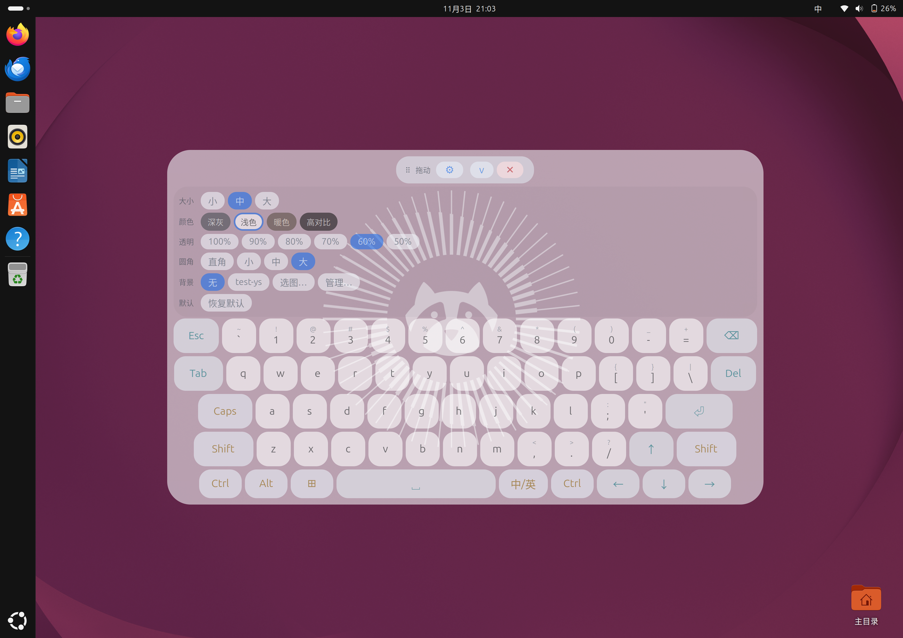
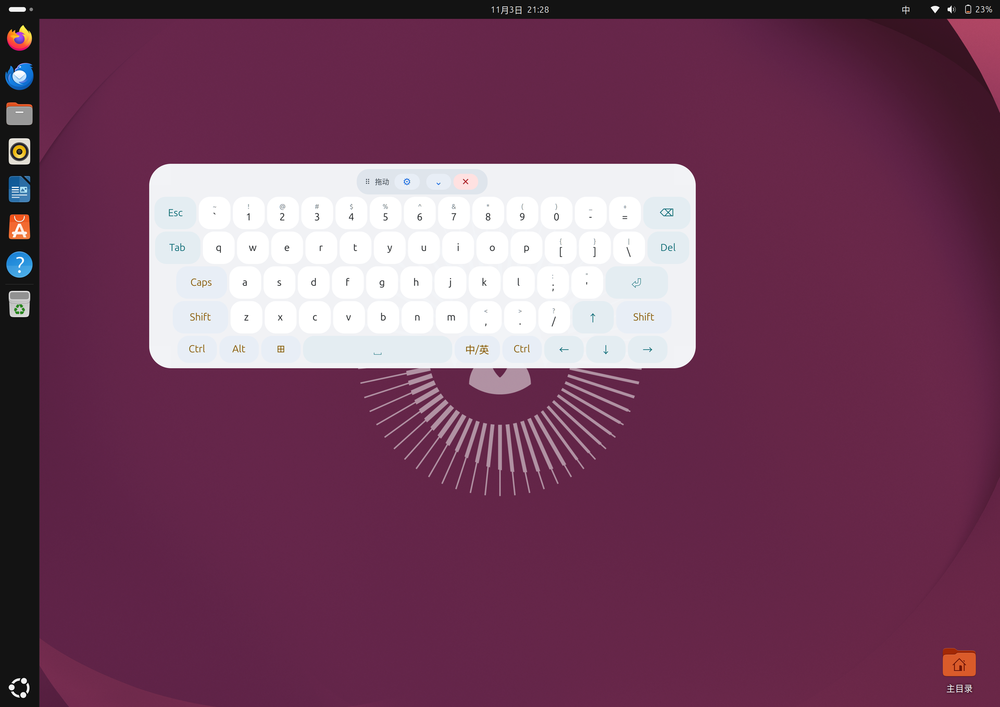
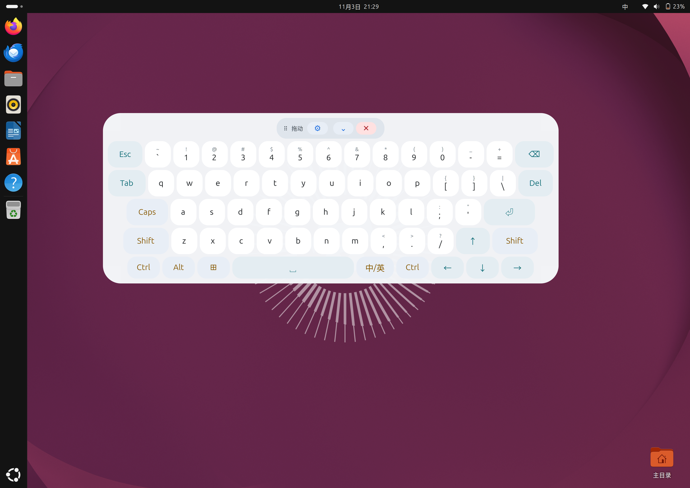
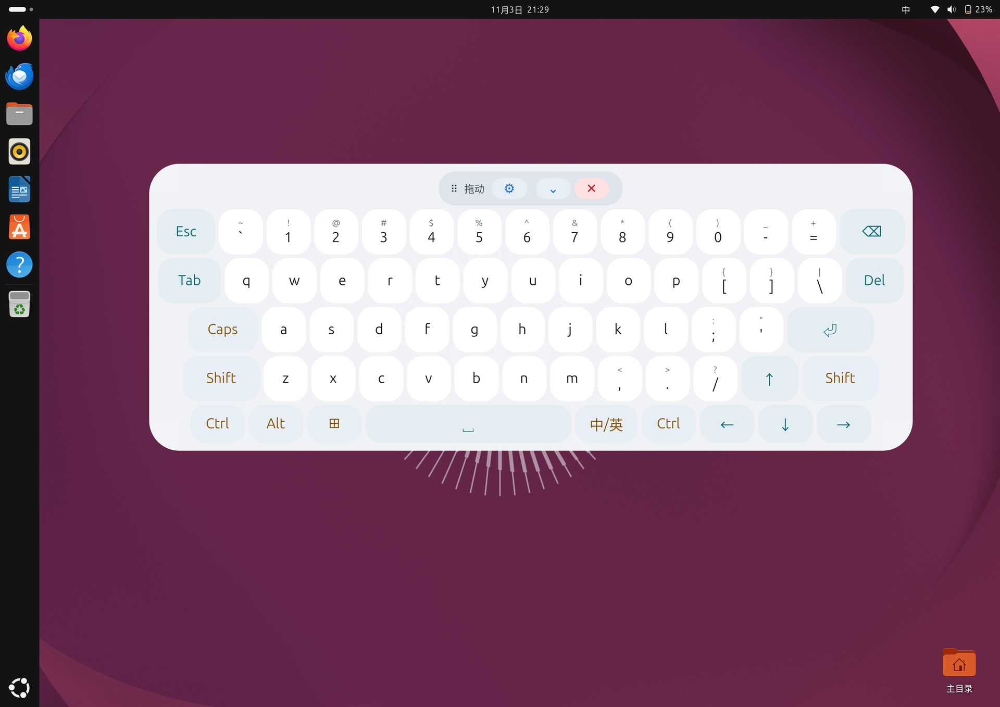

# PAD-OSK

一加 Pad 2 Pro（OPD2413 / `erhai`）在 **GNOME 50 Wayland** 下可用的屏幕键盘，其它平板请自测。
PC 风格布局、大按键、**支持中文输入**、可在系统菜单/应用抽屉里按需开关。

- 实测环境：一加 Pad 2 Pro，Ubuntu 26.04.1 LTS，GNOME Shell 50.1，arm64
- 实测应用：QQ（Electron）、Chrome、Firefox、终端 —— **均可正常输入，含中文**

> **项目主页：[mybailu.cn/osk](https://mybailu.cn/osk)** —— 功能介绍、截图、安装指引都在这里。
>
> 源码：**中国大陆用户建议访问 [Gitee 镜像](https://gitee.com/HOSHINO6/ubuntu-pad-keyboard)**，
> 下载更快、连接更稳定；**海外用户建议使用 [GitHub](https://github.com/HOSHINO61/ubuntu-pad-keyboard)**。
> 两个仓库内容对等，均可使用。

---

## 适用环境

只要能跑 **GNOME 50 Wayland**，平板和笔记本都能用——这是个普通的 GNOME Shell 扩展，
不绑定机型。下面的实测环境是一加平板 2 Pro，**其它机型请自测**：

| 项目 | 要求 |
|---|---|
| 设备 | 任何触屏设备（实测：一加平板 2 Pro / OPD2413 / `erhai` / SM8750P） |
| 系统 | 实测按 [Ubuntu for OnePlus Pad 2 Pro](https://github.com/yzddmr6/onepluspad-2pro-mainline/blob/main/README.zh-CN.md) 安装的 Ubuntu 26.04.1；别的发行版只要 GNOME 50 也能用 |
| 桌面 | **GNOME 50、Wayland 会话**（这是硬要求） |

装系统、分区、驱动问题请到对应的上游项目反馈，不要提到这里。

> X11 会话、KDE、其他合成器上不能用——本扩展依赖 GNOME Shell 的
> `Clutter.VirtualInputDevice` 和 `Main.layoutManager`。

---

## 为什么需要它

平板上只有触屏，而 GNOME Wayland 下：

- 点 QQ / Chrome 的输入框，**GNOME 自带屏幕键盘不弹**
- 装第三方屏幕键盘（Onboard）能显示，**按键却进不去应用**

根因有两条，都在协议层：

1. **GNOME 自带键盘**只在应用调用 `zwp_text_input_v3` 时出现，而
   Electron/Chromium 默认不实现该协议（[chromium#40113488](https://issues.chromium.org/issues/40113488)）
2. **Wayland 禁止跨应用注入输入**：mutter 不实现 `zwp_virtual_keyboard_v1`，
   Onboard 走 X11 `XInput`，在 Wayland 下必然失败

而且**任何普通窗口都无法做到"接受点击但不抢键盘焦点"**（xdg-shell 的限制），
所以"窗口形态的屏幕键盘"这条路在 GNOME Wayland 上走不通。

---

## 怎么做的

一个 **GNOME Shell 扩展**，跑在 mutter 进程内部：

```
GNOME Shell 进程
├─ St 按键图层（shell chrome，不是窗口 → 不参与焦点竞争）
└─ Clutter.VirtualInputDevice（mutter 内部注入 → 应用当作真实键盘事件）
```

两个直接好处：

- **注入不受限**：应用认不认 `text_input_v3` 都收得到按键
- **不抢焦点**：UI 是 shell 图层不是窗口，点键盘不会让输入框失焦

### 中文为什么能输入

注入的是 mutter 层面的**真实键盘事件**，输入法（ibus + libpinyin）照常截获。
输入法到应用有三条通道，只有第一条需要 `text_input_v3`：

| 通道 | 谁在用 | 需要 text-input-v3 |
|---|---|---|
| `zwp_text_input_v3` | 原生 Wayland 的 GTK/Qt | 需要 |
| **XIM（ibus-x11）** | **Xwayland 下的 X11 客户端** | **不需要** |
| ibus GTK 模块 | GTK 应用 | 不需要 |

所以 Electron 应用跑在 Xwayland 下就能输中文。键盘右下角的 **中/英** 键发
`Super+Space` 切换输入源。

> 这一条是本项目的关键发现：曾经一度判定"Electron 不支持 text-input，
> 所以中文无解"，实际上走的是 XIM 那条路。

---

## 功能

| 功能 | 入口 |
|---|---|
| 显示/隐藏 | 系统菜单「屏幕键盘」/ 应用抽屉 `PAD-OSK` / 键盘上的 `✕` |
| 收起成细条 | 拖动条 `⌄` / `⌃` |
| 设置面板 | 拖动条 `⚙`：尺寸、配色、透明度、背景都在里面 |
| 键盘尺寸 | `⚙` 面板 → `小` `中` `大`（三档，跨登录记忆） |
| 配色 | `⚙` 面板 → `深灰` `浅色` `暖色` `高对比`（跨登录记忆） |
| 背景透明 | `⚙` 面板 → `100%` `90%` `80%` `70%` `60%` `50%`（**整块键盘一起变淡**：底板、键面、文字、拖动条，最低 50%） |
| 圆角 | `⚙` 面板 → `直角` `小` `中` `大`（0 / 8 / 16 / 26 px，键面、面板、拖动条一起变） |
| 自定义配色 | 在 `position.kf` 的 `[custom]` 里填五个颜色，`⚙` 面板就多出「自定义」色块 |
| 自定义背景 | `⚙` 面板「背景」→ `选图…`（调**系统文件选择器**）；也可把图片放进 `~/.config/pad-osk/backgrounds/` 后直接点名字 |
| 恢复默认 | `⚙` 面板 `恢复默认`：回中档 + 深灰 + 100% + 无背景 + 屏幕底部居中 |
| 拖动定位 | 按住拖动条 `⠿ 拖动`（位置跨登录记忆） |
| 中/英切换 | 右下 `中/英` 键 |
| 粘滞修饰键 | `Ctrl` `Alt` `⊞` `Shift` `Caps`（点一次作用于下一个键） |
| 长按连发 | 按住字母/数字/符号/`⌫`/方向键连续输入，松手即停 |
| 上档符号 | `Shift` + 数字/符号键 |
| 模态对话框自动让开 | 关机/重启/注销对话框出现时键盘自动隐藏，关闭后恢复 |

布局：

```
Esc  `~  1!  2@  3#  4$  5%  6^  7&  8*  9(  0)  -_  =+   ⌫
Tab   q w e r t y u i o p  [{  ]}  \|                  Del
Caps   a s d f g h j k l  ;:  '"                      ⏎
Shift   z x c v b n m  ,<  .>  /?                    ↑  Shift
Ctrl  Alt  ⊞        [     空格     ]   中/英  Ctrl  ← ↓ →
```

尺寸可三档切换（拖动条 `⚙` → 设置面板 → `小` `中` `大`）：

| 档位 | 缩放 | 字号 | 字母键宽 | 面板（实测） | 占屏宽 |
|---|---|---|---|---|---|
| 小 | 0.72 | 17px | 46px | 927×349 | **55%** |
| 中（默认） | 0.85 | 20px | 54px | 1120×421 | **66%** |
| 大 | 0.99 | 24px | 63px | 1295×491 | **76%** |

基准（缩放 1.00）是标准的 24px 字号、64px 字母键，面板约 1310px 宽；
三档围绕它缩放。面板宽度随缩放近似线性增长，但**不是严格线性**——某些字号下
`Shift`/`Ctrl` 这类文字标签会撑破键位的 `min-width`，让整行变宽，比例会漂 1–2 %。
上表是这台平板上实测的（逻辑屏宽 1696 px），调参请对着实测数字而不是公式。

每次切换尺寸，扩展会往 journal 里记一行，方便核对：

```
erhai-osk: panel 1120x421 (66% of 1696px, step medium scale 0.85)
```
切换时**就地重排、不重建按键**（重建会让正在按下的触摸落到别的键上，产生杂字符），
底边保持不动，所以键盘向上生长、不会跑出屏幕。尺寸与位置一起存在
`~/.config/pad-osk/position.kf` 的 `[position]` 与 `[layout]` 两组里。

想微调小档和大档的比例，直接改这个文件（改完点一下尺寸按钮就生效，不用重装）：

```ini
[layout]
size=medium
theme=graphite
opacity=1.0
scale_small=0.60
scale_medium=0.80
scale_large=1.00
```

允许范围 0.40–2.00，不写就用默认 0.72 / 0.85 / 0.99。三个键都会被保存时原样保留。

### 配色

`⚙` 面板第二行是配色，四个色块按钮各自带着自己的颜色（等于预览），当前配色
描边高亮：

| 名称 | `theme=` | 说明 |
|---|---|---|
| 深灰（默认） | `graphite` | 原来的配色，对比高、夜里不刺眼 |
| 浅色 | `light` | 白键深字，白天靠窗、环境光强时更好读 |
| 暖色 | `warm` | 米黄/棕色系，长时间看不那么累 |
| 高对比 | `contrast` | 纯黑底 + 纯白/黄/青键面，视力不佳时最清楚 |

配色和尺寸一样**就地换装、不重建按键**（改色时手指还按在键上也不会出事），
保存在 `position.kf` 的 `[layout] theme=` 里，跨登录记忆；写错名字会回到深灰。

### 背景透明

`⚙` 面板第三行是 `100%` 到 `50%` 六个档（每档 10%），**整块键盘一起变淡**：
底板、键面、文字、拖动条、设置面板本身都跟着淡，看起来像一整片玻璃，而不是
"透明的框 + 实心的键"。

实现上没去改每个键的颜色，而是直接给整个键盘 actor 设 `opacity`（0–255）——
mutter 会把父节点的 alpha 一起应用到所有子节点，所以换主题、换尺寸都不用重新
计算透明叠加，两套机制互不干扰。

| 档位 | actor opacity | 观感 |
|---|---|---|
| 100% | 255 | 完全不透，和以前一样 |
| 80% | 204 | 轻微透，能隐约看到底下的窗口 |
| 50% | 128 | 下限，字还清楚，但已经明显是"浮在桌面上" |

下限卡在 50%：再低字就糊了。数值存在 `[layout] opacity=`，范围 0.50–1.00，
写超范围会被夹回边界，写坏了回到 1.0。

### 自定义配色

`⚙` 面板的颜色行默认只有四套预设。想要自己的配色，在 `position.kf` 里加一组
`[custom]`，填五个颜色（`#rrggbb`，三位简写也认）：

```ini
[custom]
panel=#1b2026
key=#333a42
mod=#3f4750
act=#3a4a4f
on=#7cc4ff
```

- 只需要这五个，**文字颜色按亮度自动取黑或白**，不用自己配前景色
- 拖动条、按钮、关闭键、选中高亮都从这五个推导出来，所以浅色盘也不会留住深色条的残影
- 五个值都合法时，`⚙` 面板的颜色行会多出一个「自定义」色块；点它就切过去，
  `theme=custom` 会被记住
- 少于五个或写错十六进制，自定义选项直接不出现（不报错、不影响预设）

### 自定义背景

点开 `⚙` 面板的「背景」行，按 `选图…` 就会调出**系统自带的文件选择器**（GNOME 的
XDG portal 对话框），选中的图片立刻铺到键盘底板上。

- **`无` 只是把图关掉，不会忘掉它**：上一张图的路径还记着，按钮也还在行里，再点
  一下就能开回来，不用重新走一遍选择器
- **`管理…`** 进入第二个界面：`backgrounds/` 里的每张图都有自己的 `✕`，删掉文件才是
  真的删除；`返回` 回到选图界面
- **删图要点两下**：第一次点 `✕` 只是把它变成 `确认删` / `取消` 两个按钮，5 秒内不点
  就自动取消——平板上误触太容易，一次点击不该等于删除文件
- `恢复默认` 只把背景**关掉**，路径照样留着——想彻底删就进 `管理…`

两种补充方式：

- 图片放进 `~/.config/pad-osk/backgrounds/`（`png` / `jpg` / `webp`），面板会把这些文件名
  直接列出来，点一下即可；目录不存在时扩展会自动创建
- 也可以直接写绝对路径：

```ini
[layout]
background=/home/user/图片/星空.webp
```

铺法是 `background-size: cover`（等比裁切填满，不拉伸）。图片被删掉时下次加载会
自动回退成无背景，日志里留一行 `background missing`。背景同样吃透明度：选 50% 时
图也跟着淡。

> 为什么走 portal：键盘是 shell 图层（chrome actor），进程里没有可用的 GTK 对话框，
> 只能用桌面的文件选择器服务。portal 不可用时退回 `zenity --file-selection`；
> 两者都没有就只保留文件夹列表。
>
> 选图期间键盘会**自动让开**：它是 chrome 图层，始终画在窗口之上，不收起就会盖住
> 选择框。选择完成或取消后自动恢复，另有 180 秒超时兜底，防止 portal 不回话时
> 键盘一直不回来。代价是选图时屏幕键盘不可用，只能用手指在对话框里点目录。

### 圆角

`⚙` 面板的 `圆角` 一行给四档：`直角` / `小` / `中` / `大`（0 / 8 / 16 / 26 px）。
它不是只改键面——面板、拖动条、按钮、设置面板全都按同一个数推导，所以放大之后
整体比例不会散：

| 档位 | `radius=` | 键面 | 面板 | 拖动条 | 小按钮 |
|---|---|---|---|---|---|
| 直角 | 0 | 0 | 16 | 10 | 8 |
| 小（默认） | 8 | 8 | 16 | 10 | 8 |
| 中 | 16 | 16 | 32 | 18 | 16 |
| 大 | 26 | 26 | 52 | 28 | 26 |

默认的 `小` 就是原来的样子，所以不选这一行什么都不会变。值存 `[layout] radius=`，
范围 0–40，手改超出范围会被夹回边界。

### 恢复默认

`⚙` 面板最后一行是 `恢复默认`，点一下把**尺寸回中档、配色回深灰、透明回 100%、
圆角回复默认、背景关掉、位置回屏幕底部居中**。

背景只是关掉，`[layout] background=` 里记的那张图还在——下次点它就回来了。真要删图，
走 `背景` → `管理…` 里的 `✕`。

`[custom]` 里你自己填的配色同理不会被删——那是你的数据，不是这个按钮的设置项。

---

## 截图

1.0 的设置面板——浅色配色、60% 透明、大圆角，五行设置全在里面：



「中」档（默认）——Quick Settings 里能看到「屏幕键盘」开关，WiFi 名称已打码：


三档尺寸（`⚙` 设置面板里选，当前档填充高亮）：

| 小（55%） | 中（66%） | 大（76%） |
|---|---|---|
|  |  |  |

三张都是同一套外观（浅色、100% 透明、圆角大、无背景），差别只在尺寸。

## 安装

```bash
sudo apt install ./dist/pad-osk_1.0_arm64.deb
```

装完建议**重启**（不建议只注销：部分设备的 gdm 登录界面偶发黑屏 + 触屏失效）。
GNOME 只在 shell 启动时扫描扩展目录，所以必须重启一次会话。

之后两种方式开关键盘：

- 右上角系统菜单 → **屏幕键盘** 开关
- 应用抽屉 → **PAD-OSK** 图标

卸载：

```bash
sudo apt remove pad-osk
```

用户配置 `~/.config/pad-osk/`（位置、开关状态、尺寸、配色）会保留。


### 从源码构建

需要 `dpkg-deb`（无需 debhelper）：

```bash
sh packaging/build-deb.sh
# → dist/pad-osk_1.0_arm64.deb
```

版本号与架构都取自 `packaging/pad-osk/DEBIAN/control`，
产物文件名自动跟随。

### 换行符（重要）

`.gitattributes` 强制 `eol=lf`，这是刻意的：

- `scripts/*.sh`、`packaging/pad-osk/DEBIAN/*` 是 Linux 脚本，
  若被检出成 CRLF，运行时报 `bad interpreter: /bin/sh^M`，安装会直接失败
- `*.deb` 标为 `binary`，不做任何转换

在 Windows 上克隆后如果不小心改坏了换行符，可以这样检查：

```bash
git ls-files --eol scripts/ packaging/pad-osk/DEBIAN/
```

**不要删除 `.gitattributes`**，也不要用白名单式 `.gitignore` 把它排除掉。

---

## 目录结构

```
README.md                    本文件
LICENSE                      MIT
.gitattributes               强制 LF 换行（见下文「换行符」）
dist/                        构建产物 (.deb)
packaging/
  build-deb.sh               打包脚本
  README.md                  打包说明（构建、命名、已知限制）
  pad-osk/DEBIAN/   control / postinst / postrm
scripts/
  erhai-osk-ext/             扩展源码
    extension.js
    metadata.json
  pad-osk-toggle.sh 应用图标调用的开关脚本
  pad-osk.desktop   应用抽屉入口
  sync-github.sh             把 master 重放为 GitHub 身份并强推（见下文）
docs/
  屏幕键盘-方案.md            完整方案：逐条排查、实现细节、全部踩坑
```

---

## 实现要点（踩过的坑）

这些是实际调试中踩出来并修掉的，详细记录见
[`docs/屏幕键盘-方案.md`](docs/屏幕键盘-方案.md)：

1. **`addTopChrome(actor, params)` 不能传 `affectsInputRegion`**
   GNOME 50 已移除该参数。传了会抛异常，但 actor **已经半加入** chrome 层，
   留下一个覆盖全屏、又不受 GNOME 键盘模块管理的图层 —— 表现为"画面在动但
   输入全死"，注销时 shell 还会卡到被 systemd `SIGKILL`。
   **正确做法：不传参数。**

2. **mutter 不实现 `wlr-layer-shell`**，`gtk4-layer-shell` 无法工作。

3. **`notify_keyval()` 不套用 shift level**
   直接送 `!` 的 keysym 会打出 `1`。上档字符必须发**基键 + 真按 `Shift_L`**。

4. **切换 Caps/Shift 时不要销毁重建按键**
   触摸的按下与抬起之间若重建控件，抬起事件可能落到同位置的另一个按钮，
   触发多余的 `clicked`（表现为莫名冒出一个字符）。改为就地更新
   `label.text` / `style`。

5. **模态对话框会盖住键盘**
   shell 启动时就把 `modalDialogGroup` 加入 `uiGroup`，而 `addTopChrome`
   是后来追加的，所以键盘在对话框之上；同时对话框 `pushModal` 抢输入，
   形成"关不掉也点不到"。**听 `child-added` 信号无效**（对话框启动时就构造好，
   之后只改可见性），正解是轮询 `modalDialogGroup` 的可见子节点。

6. **两个控制入口必须落在同一个状态上**
   早期应用图标走 `gnome-extensions enable/disable`、系统菜单走"隐藏面板"，
   两套状态导致"要点两下才生效"。改为共用状态文件
   `~/.config/pad-osk/visible`。

7. **粘滞修饰键会和全局快捷键打架**
   `⊞`（Super）是粘滞键，点 `⊞` 再点空格 = `Super+Space` = 切换输入法，
   会误切换。务必定做成独立按键、直接发完整组合键。

8. **设置面板不做成 `St.PopupMenu`**
   弹出菜单要 `pushModal` 抓一把输入，而"抓输入 + 触摸序列"正是这个项目里
   反复出问题的地方（见第 4 条）。设置面板做成键盘内部的一层内联 sheet：
   不抢 grab，开合只是显隐一个 actor，顺带复用尺寸切换那套重排逻辑。

---

## 已知限制

- 只支持 GNOME 45+（用了 ESM 扩展 API 与 `Clutter.VirtualInputDevice`），
  实测 GNOME 50.1
- 扩展代码在 shell 启动时加载，**改动后必须重启整机**；
  GNOME 50 的 `ReloadExtension` 未实现、`Eval` 已禁用，没有热重载办法
  （部分机型注销会卡在 GDM 黑屏，只能重启）
- **GDM 登录界面没有屏幕键盘**（greeter 是独立用户，看不到用户扩展）
- 长按连发走"按下即发"：按住后手指划开键盘再松手，第一个字符已经发出去了
- 当前包标注 `Architecture: arm64`；包内实际无架构相关文件，
  需要跨架构可改回 `all`

---

## 相关文档

- [Ubuntu for OnePlus Pad 2 Pro](https://github.com/yzddmr6/onepluspad-2pro-mainline/blob/main/README.zh-CN.md) —— 上游：设备适配、分区与系统安装
- [`docs/屏幕键盘-方案.md`](docs/屏幕键盘-方案.md) —— 完整技术方案与踩坑记录
- [`packaging/README.md`](packaging/README.md) —— 打包说明

## 许可

[MIT](LICENSE)
